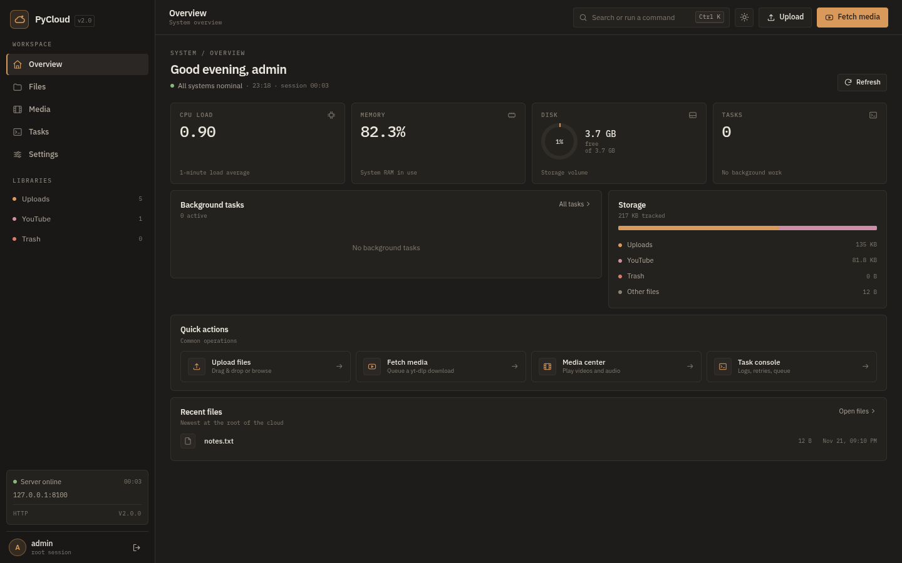
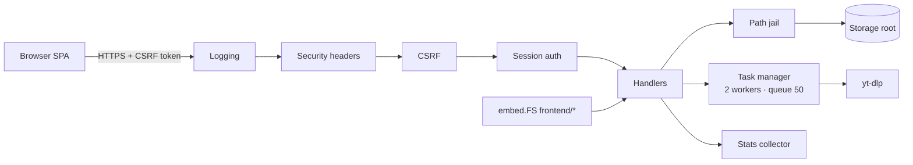

# PyCloud

PyCloud is a self-hosted personal cloud: a file manager, media player, and background download queue in one web app. The entire server — API and web UI — ships as a **single static Go binary** with no runtime, no database, and no build step for you to run it.

It is built for one person on one machine: a VPS, a home server, a Raspberry Pi, or a spare desktop.

<p>
  
  
  
</p>



## Features

- **One file to deploy** — `go:embed` packs `html`, `css`, `js`, and fonts into the executable. Copy it anywhere and run it.
- **File manager** — browse, search, multi-file drag-and-drop upload with progress and cancel, resume-capable downloads, rename, and folder creation, all inside a strict path jail.
- **Safe deletes** — "deleting" moves items to `.pycloud_trash`; deleting again from Trash erases them permanently.
- **Media library** — video, audio, and image playback in the browser with automatic `.vtt`/`.srt` subtitle pairing and poster frames generated from real video.
- **Download queue** — paste a YouTube/Vimeo/SoundCloud/Twitch/Reddit/TikTok link and yt-dlp fetches it in the background, with live logs, cancel, and retry.
- **Live telemetry** — CPU load, memory, and disk usage streamed from the server.
- **Three themes** — Graphite, Paper, and Terminal, plus a System option, stored per browser.


## Requirements

| | Requirement |
|---|---|
| **To run** | Nothing. Linux (x86_64 / arm64), macOS (Intel / Apple Silicon), or Windows (x64). |
| **To build** | [Go 1.27+](https://go.dev/dl/) and, optionally, `make`. No third-party Go modules are used. |
| **For "Fetch media" only** | [`yt-dlp`](https://github.com/yt-dlp/yt-dlp) — the app can download and configure it for you. [`ffmpeg`](https://ffmpeg.org/download.html) — needed only to merge separate video/audio streams (common for high-resolution downloads). Everything else works without these. |

## Quick start

```bash
# 1. Pick the file for your machine (see the table in Installation)
BIN=pycloud-linux-amd64

# 2. Download it from the dist URL (keeps the filename above)
curl -fL -O "https://raw.githubusercontent.com/Gaurav5189/PyCloud-Server/main/dist/${BIN}"
#    or:  wget "https://raw.githubusercontent.com/Gaurav5189/PyCloud-Server/main/dist/${BIN}"

# 3. Make it executable and run it
chmod +x "$BIN"
./"$BIN"
```

Open **https://localhost:8443** and set an admin password when prompted. On first start PyCloud generates a self-signed TLS certificate, so your browser will warn you once — that is expected for local use.

## Installation

### Prebuilt binary (recommended)

Pick the file that matches your machine:

| Platform | File |
|---|---|
| Linux x86_64 | `pycloud-linux-amd64` |
| Linux ARM64 / Raspberry Pi | `pycloud-linux-arm64` |
| macOS Apple Silicon (M1–M4) | `pycloud-darwin-arm64` |
| macOS Intel | `pycloud-darwin-amd64` |
| Windows x64 | `pycloud-windows-amd64.exe` |

**Linux and macOS** — download directly with `curl` or `wget`. Both save the file under its real name (the last part of the URL), so what you run matches the table above:

```bash
# Set this to the file for your platform (see the table above)
BIN=pycloud-linux-amd64

# Download it — the file on disk is called pycloud-linux-amd64
curl -fL -O "https://raw.githubusercontent.com/Gaurav5189/PyCloud-Server/main/dist/${BIN}"
#    or:  wget "https://raw.githubusercontent.com/Gaurav5189/PyCloud-Server/main/dist/${BIN}"

chmod +x "$BIN"
./"$BIN"
```

Want a shorter name? Rename it after downloading — or tell the downloader up front:

```bash
mv "$BIN" pycloud && ./pycloud               # after downloading
curl -fL -o pycloud "<dist-url>"             # curl: -o names the output
wget -O pycloud "<dist-url>"                 # wget: -O names the output
```

**Windows** — open the [`dist/`](https://github.com/Gaurav5189/PyCloud-Server/tree/main/dist) folder (or the [Releases](https://github.com/Gaurav5189/PyCloud-Server/releases) page), download `pycloud-windows-amd64.exe`, and run it. If SmartScreen blocks it, choose **More info → Run anyway**.

> The binaries are also attached to [GitHub Releases](https://github.com/Gaurav5189/PyCloud-Server/releases). If the direct `dist/` URLs above return 404, use the Releases page instead — see [Publishing release binaries](INSTRUCTIONS.md#publishing-release-binaries).

**Verify:** the binary prints a startup banner with the address and storage root, for example:

```
==================================================================
 ☁️  PyCloud v2.0.0 - Secure Self-Hosted Personal Cloud
==================================================================
 🌐 Address:      https://0.0.0.0:8443
 🏠 Local:        https://localhost:8443
 📁 Storage Root: /opt/pycloud/storage
 🔒 Encryption:   Enabled (TLS 1.2+)
 ⚠️  Status:       Setup Required (open browser to set admin password)
==================================================================
```

### Build from source

```bash
git clone https://github.com/Gaurav5189/PyCloud-Server.git
cd PyCloud-Server

make build       # produces ./pycloud
./pycloud
```

Other useful targets:

```bash
make test        # run the Go test suite
make release     # cross-compile all five platform binaries into dist/
make clean       # remove ./pycloud and dist/
```

### Exposing it on the internet (VPS, EC2, home server)

PyCloud's built-in certificate is self-signed, so browsers warn. To serve it on standard HTTPS with a **trusted certificate**, put [Caddy](https://caddyserver.com) in front: Caddy gets a real certificate automatically and proxies to PyCloud on localhost.

```bash
# 1. Run PyCloud on localhost only (keep TLS on)
./pycloud -bind 127.0.0.1 -port 8443 -root /srv/pycloud/storage

# 2. Install Caddy and a hostname (no signup needed — <ip>.nip.io resolves to that IP)
sudo ./deploy/install-caddy.sh 203.0.113.10.nip.io
```

Then browse to `https://203.0.113.10.nip.io`. Allow inbound **TCP 80 and 443** in the cloud firewall; 8443 no longer needs to be public. Full instructions and troubleshooting: [`deploy/README.md`](deploy/README.md).

## Usage

- **First run** — the browser shows a setup screen. Set an admin password (minimum 8 characters), or preset one with `./pycloud -set-password 'your-long-password'`.
- **Files** — drop files onto the upload zone or browse for them. Uploads land in `media/uploads` unless you are inside another folder. Use the category chips to jump to Uploads, the YouTube library, or Trash.
- **Media** — videos and images show generated thumbnails; audio appears in a list below. Click any item to open the player, which loads matching subtitles if a same-named `.vtt` or `.srt` file sits beside it.
- **Fetch media** — the **Fetch media** button queues a yt-dlp download. If yt-dlp is missing, the dialog offers to download and configure it. Track progress under **Tasks**, where each job shows live logs plus Cancel and Retry.
- **Search** — press <kbd>Ctrl</kbd>+<kbd>K</kbd> (or <kbd>⌘</kbd>+<kbd>K</kbd>) anywhere to open the command palette for navigating and running actions.
- **Themes** — change the palette under **Settings → Appearance**; the choice is stored in your browser.

## Configuration

PyCloud reads `config.json` from its working directory and creates it on first run. You can use `config.example.json` as a starting point:

```json
{
  "port": 8443,
  "bind_addr": "0.0.0.0",
  "root_dir": "./storage",
  "password_hash": "",
  "session_secret": "",
  "tls_enabled": true,
  "tls_cert_file": "certs/server.crt",
  "tls_key_file": "certs/server.key",
  "max_upload_mb": 4096,
  "trash_retention_days": 30,
  "yt_dlp_path": "yt-dlp"
}
```

| Key | Type | Default | Description |
|---|---|---|---|
| `port` | int | `8443` | Port to listen on |
| `bind_addr` | string | `"0.0.0.0"` | Interface to bind (`127.0.0.1` behind a reverse proxy) |
| `root_dir` | string | `"./storage"` | Storage root; its parent directories are created automatically |
| `password_hash` | string | `""` | PBKDF2 hash of the admin password, set by the setup screen |
| `session_secret` | string | generated | HMAC secret for signed session tokens (hex) |
| `tls_enabled` | bool | `true` | Serve HTTPS |
| `tls_cert_file` | string | `certs/server.crt` | Certificate path (self-signed is generated if missing) |
| `tls_key_file` | string | `certs/server.key` | Private key path |
| `max_upload_mb` | int | `4096` | Maximum size of a single upload request, in MB |
| `trash_retention_days` | int | `30` | Reserved; not enforced by the current release |
| `yt_dlp_path` | string | `"yt-dlp"` | yt-dlp binary name or path |

### Command-line flags

```bash
./pycloud -port 9000 -root /mnt/storage          # custom port and storage location
./pycloud -bind 127.0.0.1 -port 8080 -no-tls     # plain HTTP behind a reverse proxy
./pycloud -set-password 'MyLongPassword123'      # set the admin password and exit
./pycloud -cert /path/fullchain.pem -key /path/privkey.pem
```

| Flag | Description |
|---|---|
| `-port` | Listening port |
| `-bind` | Interface to bind to |
| `-root` | Root storage directory |
| `-no-tls` | Disable HTTPS (plain HTTP) |
| `-set-password` | Hash and store a new admin password, then exit |
| `-cert` / `-key` | Use your own TLS certificate and key |

### Environment variables

| Variable | Purpose |
|---|---|
| `PYCLOUD_CONFIG` | Path to the config file (default `config.json`) |
| `PYCLOUD_PORT` | Listening port |
| `PYCLOUD_BIND` | Bind address |
| `PYCLOUD_ROOT` | Root storage directory |
| `PYCLOUD_TLS` | `false` or `0` disables HTTPS |
| `PYCLOUD_PASSWORD` | Set or update the admin password at startup |

Precedence: **defaults → `config.json` → environment variables → command-line flags.**

## HTTP API

The web UI is a thin client over a small JSON API. Every endpoint except `status`, `setup`, and `login` requires a session.

| Method | Path | Purpose |
|---|---|---|
| GET | `/api/status` | Version, TLS state, setup/login status |
| POST | `/api/setup` · `/api/login` · `/api/logout` | Admin session lifecycle |
| GET | `/api/files?path=` | List a directory |
| POST | `/api/upload` | Multipart upload (`path`, `file`) |
| GET | `/api/download?path=&dl=1` | Download with HTTP Range support |
| POST | `/api/delete` | Move to trash, or delete permanently from trash |
| POST | `/api/rename` | Rename a file or folder |
| POST | `/api/mkdir` | Create a folder |
| GET | `/api/media/stream` · `/api/media/info` · `/api/media/subtitles` | Stream, probe, and fetch subtitles |
| GET · POST | `/api/tasks` | List tasks; queue (`add`), `cancel`, or `retry` |
| GET · POST | `/api/tasks/ytdlp-status` · `/api/tasks/install-ytdlp` | Check for and install yt-dlp |
| GET | `/api/stats` | CPU, memory, and disk telemetry |

## Architecture



Requests pass through logging, security headers, CSRF, and session-auth middleware before reaching handlers. Handlers only touch paths that resolve inside the storage root, and mutating requests must present a CSRF token. The task manager runs a bounded worker pool over a buffered queue so downloads cannot exhaust memory.

## Security

- Passwords are stored as **PBKDF2-HMAC-SHA256** hashes (200,000 iterations, 16-byte salt) and compared in constant time.
- Sessions are signed HMAC tokens in `HttpOnly`, `SameSite=Strict` cookies, valid for 24 hours.
- All mutating requests require the `pycloud_csrf` token via the `X-CSRF-Token` header.
- Failed logins are rate-limited to 5 attempts per 5 minutes per IP.
- A chroot-style path jail resolves symlinks and refuses anything outside the storage root.
- The UI renders every server value with `textContent` — no `innerHTML` — and a strict Content-Security-Policy blocks inline and third-party scripts.

## Limitations and non-goals

- **Single admin account.** There are no users, roles, or per-file permissions.
- **Self-signed TLS by default.** For a public HTTPS certificate, terminate TLS at a reverse proxy (`-bind 127.0.0.1 -no-tls`) or supply `-cert`/`-key`.
- **Trash is never purged automatically.** `trash_retention_days` is present in the config but not enforced yet; empty Trash yourself.
- **In-browser playback depends on codec support.** MP4/WebM/MP3/FLAC/images play; MKV, AVI, and some MOV files usually cannot be decoded by browsers, so the player offers a download instead.
- **Downloads are serialized.** Two workers, a 50-item queue, a 2-hour per-job timeout, and 100 tasks of history. `yt-dlp` (installable in-app) and `ffmpeg` (optional) are required for the fetch feature only.
- **Uploads are not resumable** and directories cannot be uploaded, only individual files. Downloads *do* support HTTP Range.
- **The Windows binary is unsigned**, so SmartScreen will warn on first launch.

## Troubleshooting

<details>
<summary><strong>The browser shows a certificate warning</strong></summary>

Expected on first run: PyCloud generated a self-signed certificate. Accept the warning, trust the certificate, or run behind a reverse proxy with `-no-tls`.
</details>

<details>
<summary><strong>macOS: "cannot be opened because the developer cannot be verified"</strong></summary>

```bash
xattr -d com.apple.quarantine ./pycloud
```

Or right-click the binary and choose **Open**.
</details>

<details>
<summary><strong>"listen tcp ... address already in use"</strong></summary>

Another process is on the port. Start with a different one: `./pycloud -port 9443`.
</details>

<details>
<summary><strong>Uploads fail with 413 or "exceeds maximum limit"</strong></summary>

Raise `max_upload_mb` in `config.json` and restart.
</details>

<details>
<summary><strong>"yt-dlp is not installed" when fetching media</strong></summary>

Open **Fetch media** and use **Download &amp; configure**, or install yt-dlp yourself and set `yt_dlp_path`.
</details>

<details>
<summary><strong>I forgot the admin password</strong></summary>

Stop the server, remove `config.json` (or clear `password_hash`), restart, and complete the setup screen again. This does not affect your files.
</details>

<details>
<summary><strong>Login says too many attempts</strong></summary>

Failed logins are limited to 5 per 5 minutes per IP. Wait five minutes and try again.
</details>

<details>
<summary><strong>I can't reach the server from another machine (cloud VM or remote host)</strong></summary>

PyCloud listens on **8443**, not 80 or 443. A browser **timeout** (`ERR_CONNECTION_TIMED_OUT`) means a firewall dropped the packet; a *refused* connection means nothing is listening. First confirm the server itself is healthy, then open the right port.

```bash
# Is the app serving? (bypasses the cloud firewall entirely)
curl -k https://127.0.0.1:8443/api/status      # expect {"version":"2.0.0",...}

# What address is it bound to?
ss -ltnp | grep 8443                            # macOS: lsof -i :8443
```

If `curl` works locally but not from your laptop, the network is the problem:

- **AWS EC2** — add an inbound rule for **Custom TCP 8443** in the instance's security group (Source: *My IP*). Opening 80/443 does **not** open 8443.
- **Other cloud VMs** — open 8443 in the provider firewall *and* the host firewall (`sudo ufw allow 8443/tcp`).
- **The `Network:` line in the banner is the private IP.** Browse to the instance's **public** IP or DNS name instead.
- **Prefer the standard HTTPS port?** Run `sudo ./pycloud -port 443` (ports below 1024 require root), then use `https://<public-ip>` with no port suffix.
- The self-signed certificate warning still applies — accept it and continue.
</details>

## Contributing

Bug reports and pull requests are welcome. PyCloud uses only the Go standard library and a no-build frontend, so the toolchain stays small.

```bash
git clone https://github.com/Gaurav5189/PyCloud-Server.git
cd PyCloud-Server
make test        # go test ./...
make build       # build ./pycloud, then run it to try the UI
```

Please open an issue before large changes so the approach can be discussed first. Maintainer notes — local setup, debugging, and cutting a release — live in [INSTRUCTIONS.md](INSTRUCTIONS.md).

## License

Released under the [MIT License](LICENSE).

IBM Plex Sans and IBM Plex Mono are bundled under `frontend/fonts/` under the SIL Open Font License.
