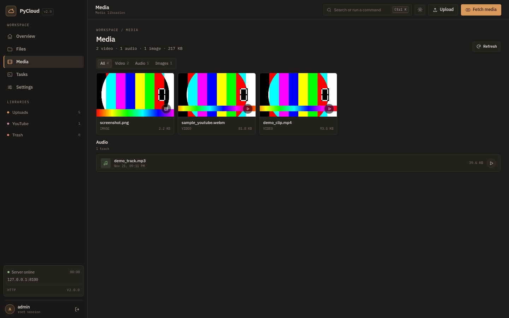

<div align="center">

# ☁️ PyCloud v2.0  
### Next-Gen Self-Hosted Personal Cloud & Media Engine

A secure, high-performance, self-hosted **private cloud, file manager, cinema media server, and background task engine** delivered as a **single, zero-dependency static executable** for **Linux, macOS, and Windows**.

**Zero external runtimes needed. Download one file and run.**


<br>


</div>

---

## 🚀 What's New in v2.0?

PyCloud v2.0 is a complete ground-up rewrite engineered to resolve all 28 vulnerabilities found in previous versions while fulfilling the goal of a **single runnable file for all machines** without requiring Python, pip, or virtual environments:

| Feature / Metric | Legacy v8.6 (Python) | PyCloud v2.0 (New Binary) |
|---|---|---|
| **Runtime Dependencies** | Python 3.x, pip, system libs | **Zero (100% self-contained static executable)** |
| **Cross-Platform Support** | Linux-centric (`/proc/`, `setsid`) | **Linux (x86_64, ARM64/RPi), macOS (Intel/M-series), Windows** |
| **Network Encryption** | Cleartext HTTP only | **Built-in HTTPS with automatic TLS certificate generation** |
| **Authentication** | Hardcoded plaintext credentials | **PBKDF2-HMAC-SHA256, constant-time compare, brute-force rate limiter** |
| **Session Security** | Cleartext Basic Auth | **Cryptographically signed HMAC tokens in HttpOnly/Strict cookies** |
| **CSRF Defense** | None | **Synchronizer token pattern on all state-changing endpoints** |
| **File Jail / Path Security** | Vulnerable to symlink traversal | **Chroot-style path jail with symlink resolution & atomic writes** |
| **File Overwriting** | Silently replaced existing files | **Automatic safe deduplication (`filename (1).ext`)** |
| **Media Downloader** | Command injection & SSRF risks | **URL allowlisting, flag disallow, SSRF filter, context cancellation** |
| **Task Engine** | Unbounded memory growth | **Bounded worker pool, channel queue, ring buffer auto-eviction** |
| **Executable Size** | Script + Python runtime | **~7.5 MB standalone stripped executable** |

---

## ✨ Key Features

### 🖥 Interactive Dark Mode Dashboard
- **Live System Telemetry** — Real-time CPU load, RAM utilization, and disk space gauges.
- **Embedded Web Client** — HTML, CSS, JS, and icons are embedded directly inside the binary via `//go:embed`.
- **Instant Search** — High-speed client-side filtering across directories.

### 📁 Advanced File Management
- **Multi-File Drag & Drop Uploads** — Real-time percentage progress bar and upload cancellation.
- **Resumable Downloads** — HTTP Range (`206 Partial Content`) request support.
- **Trash Bin Protection** — Safe deletion moves items to `.pycloud_trash` before permanent removal.
- **Safe Rename & Folders** — In-browser renaming and folder creation inside a secure jail.

### 🎬 Cinema Mode Media Streaming
- **Video Player** — Native streaming for MP4, MKV, WebM, MOV with instant seek.
- **Auto Subtitle Pairing** — Automatically detects and loads adjacent `.vtt` and `.srt` subtitle files.
- **Audio & Image Viewer** — In-browser high-fidelity playback.

### ⚡ Hardened Background Task Engine
- **Media Fetcher** — Download media from YouTube, Vimeo, Soundcloud, Twitch, Reddit, TikTok, etc.
- **Live Task Console** — Real-time process logs, task cancellation, and retry capabilities.
- **Isolated Execution** — Strictly blocks argument injections and private/internal network access.

---

## ⚡ Quick Start

### 1. Download the Binary
Download the pre-compiled binary for your system from the [`dist/`](dist/) folder:

- **Linux (x86_64):** `pycloud-linux-amd64`
- **Raspberry Pi / Linux ARM64:** `pycloud-linux-arm64`
- **macOS Apple Silicon (M1/M2/M3/M4):** `pycloud-darwin-arm64`
- **macOS Intel:** `pycloud-darwin-amd64`
- **Windows (x64):** `pycloud-windows-amd64.exe`

### 2. Run PyCloud
```bash
# On Linux / macOS:
chmod +x pycloud
./pycloud

# On Windows:
pycloud-windows-amd64.exe
```

That's it! Open your web browser to:
```
https://localhost:8443
```
*(On first run, PyCloud will automatically generate a self-signed TLS certificate and prompt you to set an admin password).*

---

## ⚙️ Configuration & Flags

PyCloud creates a `config.json` file in its working directory, or you can customize it via command-line flags or environment variables:

```bash
# Run on custom port with custom storage location:
./pycloud -port 9000 -root /mnt/storage

# Bind only to localhost (safe for reverse proxy like Caddy / Nginx):
./pycloud -bind 127.0.0.1 -port 8080 -no-tls

# Set admin password directly from command line:
./pycloud -set-password "MySuperSecretPassword123!"

# Use custom TLS certificates:
./pycloud -cert /path/to/fullchain.pem -key /path/to/privkey.pem
```

### Environment Variables
- `PYCLOUD_PORT`: Override HTTP/HTTPS listening port.
- `PYCLOUD_BIND`: Override bind address (`127.0.0.1` or `0.0.0.0`).
- `PYCLOUD_ROOT`: Override root storage directory.
- `PYCLOUD_TLS`: Set to `false` to disable TLS.
- `PYCLOUD_PASSWORD`: Set or update admin password.

---

## 🛠 Building from Source

PyCloud uses standard Go without any third-party external dependencies:

```bash
# Clone the repository
git clone https://github.com/Gaurav5189/PyCloud-Server.git
cd PyCloud-Server

# Run tests
make test

# Build single stripped binary
make build

# Cross-compile for all operating systems (Linux, Mac, Windows)
make release
```

---

## 📜 Security Architecture & Audit Report

PyCloud v2.0 was designed directly from an exhaustive security audit. Full vulnerability remediations:

| Finding | Remediation in v2.0 |
|---|---|
| **C1: Plaintext Credentials** | Config stored PBKDF2-HMAC-SHA256 salted hashes. |
| **C2: Cleartext HTTP** | Native TLS 1.2+ server with auto-generated self-signed certificates. |
| **C3: `yt-dlp` Command Injection** | URL whitelist (`https://`), `--` argument separator, strict flag blocking. |
| **C4: Symlink Path Traversal** | Chroot-style `SafePathJail` evaluates symlinks and canonical boundaries. |
| **C5: Arbitrary Media File Read** | Extension whitelist; jailed file paths only. |
| **H1: Brute Force Attacks** | In-memory token-bucket rate limiter (5 failed attempts per 5 minutes per IP). |
| **H3 & H4: Stored & DOM XSS** | 100% textContent rendering; all user input strictly sanitized in DOM. |
| **H5: Cross-Site Request Forgery** | Double-submit / anti-CSRF token verification on all POST/DELETE/PATCH. |
| **H7: Overwriting Uploads** | Non-destructive atomic writes and automatic deduplication naming. |
| **H8: Server-Side Request Forgery** | Blocks `file://`, private RFC1918 subnets, and loopback IPs. |

---

## 🖼 Screenshots

| Dashboard & Files | Media Download & Tasks |
|:---:|:---:|
|  |  |

---

## 📜 License

Open Source under the MIT License. Free to modify, self-host, and use.

<div align="center">

**Your files. Your server. Your control.**

</div>
