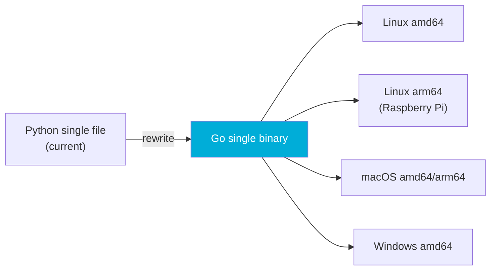
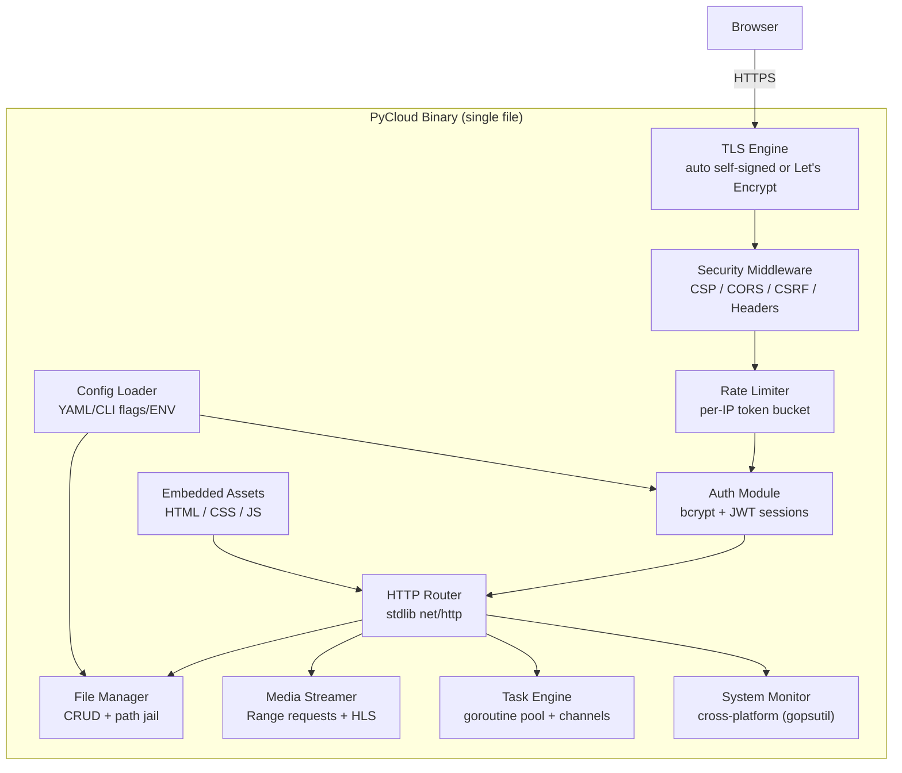

# ☁️ PyCloud v2.0 — Complete Rewrite Plan

## Table of Contents
1. [Current State Analysis](#1-current-state-analysis)
2. [Security Audit Summary (28 Findings)](#2-security-audit-summary)
3. [Framework Decision](#3-framework-decision)
4. [Architecture Design](#4-architecture-design)
5. [Implementation Plan (Phased)](#5-implementation-plan)
6. [Edge Cases & Hardening](#6-edge-cases--hardening)
7. [File Structure](#7-file-structure)

---

## 1. Current State Analysis

**What we have:** A single 454-line Python file ([secure_server.py](file:///home/gav/out-source/PyCloud-Server/secure_server.py)) that is a self-hosted personal cloud with file management, media streaming, YouTube downloading, and a background task engine.

**What works well (keep):**
- ✅ Single-file deployment philosophy — users love this
- ✅ Dark-theme modern UI
- ✅ Background task manager with live logs
- ✅ YouTube/media download integration
- ✅ System stats dashboard (CPU, RAM, Disk)
- ✅ File upload with progress bar and cancel

**What's broken (fix):**
- ❌ 28 security vulnerabilities (see §2)
- ❌ Linux-only (`/proc/meminfo`, `os.setsid`, `os.killpg`)
- ❌ No HTTPS
- ❌ Hardcoded credentials
- ❌ No configuration file — must edit source code
- ❌ Deprecated `cgi` module
- ❌ HTML embedded as giant string — unmaintainable

---

## 2. Security Audit Summary

> [!CAUTION]
> The current codebase has **6 CRITICAL**, **8 HIGH**, **9 MEDIUM**, and **5 LOW** severity findings. Every single one must be addressed in v2.

### 🔴 CRITICAL (6)

| # | Finding | Location | Exploit |
|---|---------|----------|---------|
| C1 | **Hardcoded plaintext credentials** | [L18-19](file:///home/gav/out-source/PyCloud-Server/secure_server.py#L18-L19) | Credentials in source code committed to git; anyone with repo access owns the server |
| C2 | **No HTTPS — credentials sent in cleartext** | [L452](file:///home/gav/out-source/PyCloud-Server/secure_server.py#L452) | Basic Auth base64 is trivially decoded; Wireshark on same network = instant password theft |
| C3 | **Command injection via yt-dlp** | [L412-416](file:///home/gav/out-source/PyCloud-Server/secure_server.py#L412-L416) | Attacker passes `--exec "rm -rf /"` as URL — yt-dlp executes shell commands via its own argument parser |
| C4 | **Path traversal in file delete** | [L419-425](file:///home/gav/out-source/PyCloud-Server/secure_server.py#L419-L425) | `startswith()` bypassable via symlinks; TOCTOU race between `abspath` check and `os.remove` |
| C5 | **Path traversal in media player** | [L156-160](file:///home/gav/out-source/PyCloud-Server/secure_server.py#L156-L160) | `/watch?v=../../../etc/passwd` — `render_player` takes user input directly as file path, no validation |
| C6 | **Arbitrary file read via SimpleHTTPRequestHandler** | [L395](file:///home/gav/out-source/PyCloud-Server/secure_server.py#L395) | `super().do_GET()` fallback serves ANY file under CWD; `os.chdir(ROOT_DIR)` makes CWD the root dir |

### 🟠 HIGH (8)

| # | Finding | Location | Impact |
|---|---------|----------|--------|
| H1 | **No brute-force protection** | [L100-104](file:///home/gav/out-source/PyCloud-Server/secure_server.py#L100-L104) | Unlimited auth attempts; automated tools crack password in minutes |
| H2 | **Timing attack on credential comparison** | [L102](file:///home/gav/out-source/PyCloud-Server/secure_server.py#L102) | String `!=` comparison leaks password length via response timing |
| H3 | **Stored XSS via filenames** | [L361-370](file:///home/gav/out-source/PyCloud-Server/secure_server.py#L361-L370) | Upload file named `.txt` → filename rendered unescaped in HTML |
| H4 | **DOM XSS via innerHTML in task rendering** | [L219-237](file:///home/gav/out-source/PyCloud-Server/secure_server.py#L219-L237) | Task target/logs inserted via `innerHTML` with template literals; attacker-controlled YouTube URL renders as HTML |
| H5 | **No CSRF protection** | [L368](file:///home/gav/out-source/PyCloud-Server/secure_server.py#L368) | Delete forms have no token; malicious page can trigger file deletion via cross-origin POST |
| H6 | **No upload size limit** | [L400-407](file:///home/gav/out-source/PyCloud-Server/secure_server.py#L400-L407) | Attacker uploads 100GB file → disk exhaustion DoS |
| H7 | **Uploads silently overwrite existing files** | [L406](file:///home/gav/out-source/PyCloud-Server/secure_server.py#L406) | No duplicate name detection; upload "important.pdf" and it replaces existing one |
| H8 | **SSRF via yt-dlp URL** | [L415](file:///home/gav/out-source/PyCloud-Server/secure_server.py#L415) | Pass `file:///etc/shadow` or internal network URLs to yt-dlp — it fetches them |

### 🟡 MEDIUM (9)

| # | Finding | Impact |
|---|---------|--------|
| M1 | **Binding to 0.0.0.0** | Server exposed to all network interfaces by default |
| M2 | **No security headers** | No CSP, X-Frame-Options, HSTS, X-Content-Type-Options |
| M3 | **Bare `except: pass` everywhere** | Errors silently swallowed; attacks leave no trace |
| M4 | **Task list grows unbounded** | Memory leak; no cleanup of completed tasks |
| M5 | **8-char UUID truncation for task IDs** | Collision probability ~1 in 4 billion, but still unnecessary risk |
| M6 | **Deprecated `cgi` module** | Removed in Python 3.13; code will break |
| M7 | **`os.chdir(ROOT_DIR)` is thread-unsafe** | CWD is process-global; concurrent requests see wrong directory |
| M8 | **No Content-Length validation** | Missing/negative Content-Length → crash or memory exhaustion |
| M9 | **Rename path traversal** | `os.path.basename` on new_name is good, but old_rel is user-controlled |

### 🔵 LOW (5)

| # | Finding | Impact |
|---|---------|--------|
| L1 | **Linux-only system stats** | `/proc/meminfo` and `os.getloadavg()` don't exist on Windows/Mac |
| L2 | **No request timeout** | Slow loris DoS possible |
| L3 | **No connection limit** | `ThreadingMixIn` spawns unlimited threads |
| L4 | **`os.setsid`/`os.killpg` not cross-platform** | Windows doesn't have process groups |
| L5 | **Logout doesn't work** | Basic Auth has no server-side session to invalidate |

---

## 3. Framework Decision

### Options Evaluated

| Criteria | Python (stdlib) | Python + PyInstaller | Go | Rust (Axum) |
|:---------|:---:|:---:|:---:|:---:|
| **True single file, zero deps** | ⚠️ Needs Python installed | ✅ Self-contained exe | ✅ Static binary | ✅ Static binary |
| **Cross-compile from one OS** | N/A | ❌ Must build per-OS | ✅ `GOOS`/`GOARCH` | ✅ via `cross` |
| **Binary size** | 0 (script) | 5-10 MB | 5-8 MB | 3-6 MB |
| **Embed HTML/CSS/JS** | ✅ String in code | ✅ String in code | ✅ `//go:embed` | ✅ `rust-embed` |
| **HTTP ecosystem** | ⚠️ stdlib basic | ⚠️ stdlib basic | ✅ Excellent stdlib | ✅ Axum/Actix mature |
| **TLS built-in** | ✅ `ssl` module | ✅ `ssl` module | ✅ stdlib | ✅ `rustls` |
| **Memory safety** | ⚠️ GC'd but no guarantees | ⚠️ Same | ✅ GC'd | ✅ Borrow checker |
| **Learning curve (for you)** | ✅ Already Python | ✅ Already Python | 🟡 Moderate | 🔴 Steep |
| **WebSocket support** | ❌ Manual | ❌ Manual | ✅ gorilla/ws | ✅ tokio-tungstenite |
| **Your target audience** | ✅ RPi/VPS users | ✅ Anyone | ✅ Anyone | ✅ Anyone |

### 🏆 Recommendation: **Go (Golang)**



**Why Go wins for PyCloud v2:**

1. **True single binary** — `go build` produces one static executable. No Python runtime, no pip, no venv. Download and run.
2. **Cross-compile from ONE machine** — `GOOS=windows GOARCH=amd64 go build` builds a Windows .exe from Linux. Ship all 3 platforms from GitHub Actions in one workflow.
3. **`//go:embed`** — Compile HTML/CSS/JS directly into the binary. No external template files to lose.
4. **Excellent HTTP stdlib** — Go's `net/http` is production-grade (powers Kubernetes, Docker, Caddy). Built-in TLS, file serving, multiplexing, timeouts.
5. **Goroutines** — Lightweight concurrency for the task manager replaces Python's fragile threading.
6. **5-8 MB binary** — Tiny. Runs on a Raspberry Pi Zero.
7. **Community** — FileBrowser, Dufs-like tools are written in Go/Rust for exactly this reason.

> [!IMPORTANT]
> **Alternative if you prefer staying in Python:** Keep the single `.py` file, add `ssl`, `secrets`, `hmac`, CSRF tokens, replace `cgi` with `email.parser`/manual multipart parsing, and distribute with PyInstaller. This is viable but won't give you true zero-dependency single-binary cross-platform distribution. I'll cover both paths in the implementation plan.

---

## 4. Architecture Design

### v2 Architecture (Go)



### Module Breakdown

| Module | Responsibility | Key Decisions |
|--------|---------------|---------------|
| **Config** | Load from `config.yaml`, CLI flags, or ENV vars | First-run wizard generates config + self-signed cert |
| **Auth** | bcrypt password hashing, JWT session tokens in HttpOnly cookies | Constant-time comparison, rate-limited login (5 attempts/min), session expiry |
| **Router** | RESTful API + SPA frontend | `GET /api/files`, `POST /api/upload`, `DELETE /api/files/:path`, `GET /api/tasks`, `POST /api/yt` |
| **File Manager** | List, upload, download, rename, delete | Chroot-style path jail using `filepath.Rel` + symlink resolution, atomic writes |
| **Media** | Stream video/audio/images | HTTP Range headers for seeking, proper MIME types, subtitle support |
| **Task Engine** | Background job queue | Bounded goroutine pool (N workers), channel-based queue, auto-cleanup after 1hr |
| **Stats** | CPU, RAM, Disk | Use `shirou/gopsutil` for cross-platform stats |
| **Security MW** | HTTP security headers, CSRF, rate limiting | CSP, X-Frame-Options: DENY, HSTS, per-IP sliding window rate limiter |
| **TLS** | HTTPS everywhere | Auto-generate self-signed cert on first run; optional Let's Encrypt via `autocert` |

---

## 5. Implementation Plan

### Phase 0: Project Setup *(Day 1)*

- [ ] Initialize Go module: `go mod init github.com/Gaurav5189/PyCloud-Server`
- [ ] Set up project structure (see §7)
- [ ] Create GitHub Actions CI/CD for cross-platform builds
- [ ] Set up linting (`golangci-lint`) and security scanning (`gosec`)

### Phase 1: Core Security Foundation *(Days 2-3)*

> [!WARNING]
> This phase must be completed FIRST. Every other feature builds on top of secure foundations.

- [ ] **Config system** — YAML config file with CLI flag overrides and ENV var support
  - Port, bind address, root directory, password hash, TLS cert paths
  - First-run interactive setup: prompt for password, generate bcrypt hash, create `config.yaml`
- [ ] **TLS/HTTPS** — Auto-generate self-signed certificate on first run
  - Store cert in `~/.pycloud/certs/`
  - Optional: Accept user-provided cert/key paths
  - Force HTTPS redirect if HTTP attempted
- [ ] **Authentication** — Replace Basic Auth with session-based auth
  - bcrypt-hashed password stored in config (never plaintext)
  - Login page (HTML form) → server validates → issues JWT in HttpOnly/Secure/SameSite=Strict cookie
  - Constant-time password comparison (`subtle.ConstantTimeCompare`)
  - Rate limiting: max 5 failed logins per IP per 5 minutes (sliding window)
  - Real logout: server invalidates session token
- [ ] **Security middleware** — Applied to ALL routes
  - `Content-Security-Policy: default-src 'self'; script-src 'self'; style-src 'self' 'unsafe-inline'`
  - `X-Frame-Options: DENY`
  - `X-Content-Type-Options: nosniff`
  - `Strict-Transport-Security: max-age=31536000`
  - `Referrer-Policy: no-referrer`
  - CSRF token generation + validation on all state-changing requests

### Phase 2: File Manager *(Days 4-5)*

- [ ] **Path security jail** — The most critical component
  ```
  User Input → URL decode → filepath.Clean → filepath.Join(rootDir, cleaned)
  → os.Lstat (check symlink) → filepath.EvalSymlinks → verify startsWith(rootDir)
  → ONLY THEN perform operation
  ```
  - Reject paths containing `..`, null bytes, or non-UTF8
  - Resolve symlinks BEFORE checking containment (prevents symlink escape)
  - All operations use the resolved absolute path
- [ ] **File listing** — `GET /api/files?path=subdir`
  - Return JSON: `[{name, size, modified, isDir, mimeType}]`
  - Pagination for large directories (100 files per page)
  - Hidden file filtering (configurable)
  - HTML-escape all filenames in API responses
- [ ] **Upload** — `POST /api/upload`
  - Configurable max upload size (default 2GB, enforced server-side via `http.MaxBytesReader`)
  - Sanitize filename: strip path components, replace dangerous chars, limit length to 255
  - Duplicate detection: append `(1)`, `(2)` etc. instead of overwriting
  - Atomic writes: upload to temp file → rename on completion (prevents partial files)
  - File type allowlist (optional, configurable)
- [ ] **Download** — `GET /api/download?path=file.txt`
  - Proper `Content-Disposition` headers
  - Range request support for resumable downloads
- [ ] **Delete** — `DELETE /api/files?path=file.txt`
  - Path jail validation (see above)
  - Move to trash (`.pycloud_trash/`) instead of immediate deletion
  - Trash auto-cleanup after 30 days
  - Confirmation required via CSRF-protected request
- [ ] **Rename** — `PATCH /api/files`
  - Path jail on BOTH old and new paths
  - Reject rename if destination exists
  - Sanitize new name same as upload filename

### Phase 3: Media & Streaming *(Day 6)*

- [ ] **Video streaming** with proper HTTP Range support
  - Parse `Range` header, return `206 Partial Content` with correct `Content-Range`
  - Support seeking in MP4/MKV/WebM
  - Proper MIME type detection (don't trust extension alone — use `http.DetectContentType` on first 512 bytes)
- [ ] **Image viewer** — Serve images with correct MIME types
- [ ] **Audio player** — Stream MP3/FLAC/OGG with Range support
- [ ] **Subtitle support** — Serve `.vtt`/`.srt` files alongside media
- [ ] **Media player page** — Embedded HTML5 player with subtitle track

### Phase 4: Task Engine & yt-dlp Integration *(Days 7-8)*

- [ ] **Goroutine pool task engine**
  - Bounded worker pool (configurable, default: 3 concurrent tasks)
  - Channel-based job queue with max queue depth (default: 50)
  - Task states: `queued → running → completed/failed/cancelled`
  - Auto-cleanup: remove completed tasks after 1 hour
  - Full task IDs (UUID v4, no truncation)
- [ ] **yt-dlp integration** — Hardened
  - **URL validation**: Only allow `https://` URLs matching known video site patterns (YouTube, Vimeo, etc.)
  - **Argument injection prevention**: Reject any input starting with `-` or `--`
  - **Command construction**: Only use whitelisted yt-dlp flags
  - **Sandboxing**: Run yt-dlp with `--no-exec`, `--no-config`, `--restrict-filenames`
  - **Network policy**: Block `file://`, `ftp://`, internal IPs (10.x, 192.168.x, 127.x, 172.16-31.x)
  - **Output validation**: Verify downloaded file is in expected directory
- [ ] **Task API**
  - `GET /api/tasks` — List all tasks with status and recent logs
  - `POST /api/tasks` — Create new task (yt-dlp download)
  - `DELETE /api/tasks/:id` — Cancel running task
  - `POST /api/tasks/:id/retry` — Retry failed task
- [ ] **Process management** — Cross-platform
  - Use Go's `exec.CommandContext` with context cancellation (replaces `os.killpg`)
  - Timeout on subprocess execution (configurable, default 2 hours)

### Phase 5: System Monitor *(Day 9)*

- [ ] **Cross-platform stats** using `shirou/gopsutil`
  - CPU usage percentage (not load average — works on all OSes)
  - RAM usage percentage and available memory
  - Disk usage for root directory
  - System uptime
  - Server uptime
- [ ] **Stats API** — `GET /api/stats`
  - Return JSON with all metrics
  - Cache stats for 2 seconds (don't hammer the OS on every poll)

### Phase 6: Frontend Rewrite *(Days 10-12)*

- [ ] **SPA architecture** — Single HTML page, all interaction via fetch API
- [ ] **Embedded via `//go:embed`** — All HTML/CSS/JS compiled into binary
- [ ] **Template-free rendering** — All dynamic content via JSON API + JS DOM manipulation
- [ ] **Security hardening**
  - All user-generated content rendered via `textContent` (never `innerHTML`)
  - CSRF token included in all POST/DELETE/PATCH requests (from meta tag)
  - No inline scripts (CSP compliant)
- [ ] **UI improvements**
  - Drag-and-drop upload zone
  - Multi-file upload with individual progress bars
  - Breadcrumb navigation for subdirectories
  - File type icons
  - Sort by name/size/date
  - Responsive mobile layout
  - Keyboard shortcuts (Delete, Rename, Upload)
  - Dark/Light theme toggle (persist in localStorage)
  - Toast notifications instead of `alert()`

### Phase 7: Polish & Distribution *(Days 13-14)*

- [ ] **First-run experience**
  - If no `config.yaml` exists, start interactive CLI setup
  - Ask for: password, root directory, port
  - Generate self-signed TLS cert
  - Create config file
  - Print access URL with https://
- [ ] **Graceful shutdown** — Handle SIGINT/SIGTERM, finish active uploads, close connections
- [ ] **Logging** — Structured JSON logging with levels (info/warn/error)
  - Log all auth attempts (success + failure + source IP)
  - Log all file operations
  - Configurable log file path
- [ ] **GitHub Actions CI/CD**
  ```yaml
  # Build matrix
  - linux/amd64
  - linux/arm64 (Raspberry Pi)
  - darwin/amd64
  - darwin/arm64 (Apple Silicon)
  - windows/amd64
  ```
  - Auto-create GitHub Release with all binaries on tag push
  - SHA256 checksums for all binaries
- [ ] **README rewrite** — Installation is now: download binary → run → open browser

---

## 6. Edge Cases & Hardening

### File System Edge Cases

| Edge Case | How v2 Handles It |
|-----------|-------------------|
| Filename with `../` | Stripped by `filepath.Clean` before any operation |
| Filename with null bytes (`\x00`) | Rejected at input validation layer |
| Filename with HTML (`<script>`) | HTML-escaped in all API responses; rendered via `textContent` in frontend |
| Symlink pointing outside root | `filepath.EvalSymlinks` resolves real path → containment check rejects it |
| Upload of 100GB file | `http.MaxBytesReader` enforces server-side limit; returns 413 |
| Upload same filename twice | Auto-append `(1)`, `(2)` etc. — never silently overwrite |
| Delete root directory itself | Reject: resolved path equals root dir exactly |
| Rename to existing file | Return 409 Conflict |
| Rename with path separator | `filepath.Base` strips directory components |
| File disappears between list and read | Return 404 gracefully (no crash) |
| Non-UTF8 filenames | Skip in listing; log warning |
| Very long filenames (>255 chars) | Truncate to 255 chars |
| Dot files (`.hidden`) | Configurable: show/hide (default: hide) |
| Empty directory | Show "empty" state in UI (not broken layout) |
| Thousands of files in one directory | Paginate API response (100 per page) |
| Disk full during upload | Atomic write fails → temp file cleaned up → return 507 |

### Network Edge Cases

| Edge Case | How v2 Handles It |
|-----------|-------------------|
| Slow loris attack | `ReadTimeout: 30s`, `WriteTimeout: 60s`, `IdleTimeout: 120s` on HTTP server |
| Brute force login | Rate limit: 5 attempts per IP per 5 min; exponential backoff |
| Concurrent uploads | Each upload gets own goroutine; bounded by max connections |
| Connection during shutdown | Graceful: finish active requests within 30s, then force close |
| Invalid Content-Length | Validate as positive integer; reject if missing on POST |
| Request body too large | `MaxBytesReader` on all POST endpoints |
| Malformed multipart data | Return 400 with generic error (no stack trace leak) |
| WebSocket connection hijack | Not applicable (v2 uses SSE or polling, not WebSocket) |

### yt-dlp Edge Cases

| Edge Case | How v2 Handles It |
|-----------|-------------------|
| URL is `file:///etc/shadow` | Reject: only `https://` URLs from allowlist domains |
| URL is `--exec rm -rf /` | Reject: input starting with `-` is blocked |
| URL is internal IP (`http://192.168.1.1/admin`) | Reject: private IP ranges blocked |
| yt-dlp hangs forever | Context timeout (2 hours), then `SIGKILL` |
| yt-dlp downloads 50GB video | Configurable max download size; check disk space before starting |
| yt-dlp not found on system | Graceful error: "yt-dlp not installed" message; feature disabled |
| Concurrent download queue overflow | Max 50 queued tasks; return 429 Too Many Requests |

### Authentication Edge Cases

| Edge Case | How v2 Handles It |
|-----------|-------------------|
| Expired JWT token | Return 401; redirect to login page |
| Stolen JWT cookie | `HttpOnly` + `Secure` + `SameSite=Strict` flags prevent theft |
| Multiple browser tabs | Same session cookie works across tabs |
| Password change | Invalidate all existing sessions |
| First run, no password set | Interactive setup wizard; refuse to start without password |
| Empty password | Reject: minimum 8 characters enforced |

---

## 7. File Structure

```
PyCloud-Server/
├── go.mod
├── go.sum
├── main.go                    # Entry point, CLI flags, server startup
├── config.go                  # Config loading (YAML + ENV + flags)
├── auth.go                    # Login, JWT, bcrypt, rate limiting
├── middleware.go              # Security headers, CSRF, logging
├── files.go                   # File CRUD, path jail, upload/download
├── media.go                   # Range streaming, MIME detection
├── tasks.go                   # Task engine, yt-dlp integration
├── stats.go                   # System stats (gopsutil)
├── frontend/                  # Embedded via //go:embed
│   ├── index.html
│   ├── css/
│   │   └── style.css
│   ├── js/
│   │   ├── app.js             # Main SPA logic
│   │   ├── auth.js            # Login form handling
│   │   ├── files.js           # File list, upload, delete, rename
│   │   ├── media.js           # Media player
│   │   └── tasks.js           # Task manager UI
│   └── icons/                 # File type icons (SVG)
├── config.example.yaml        # Example configuration
├── .github/
│   └── workflows/
│       └── release.yml        # Cross-platform build + release
├── .goreleaser.yaml           # GoReleaser config for multi-platform builds
├── README.md
└── LICENSE
```

> [!NOTE]
> All Go files are in the root package for simplicity — this keeps the "feel" of a small, self-contained project. If the codebase grows beyond ~2000 lines, we can refactor into internal packages.

---

## Summary: What Changes for the User

| Aspect | v8.6 (Current) | v2.0 (New) |
|--------|----------------|------------|
| **Install** | Install Python, clone repo, edit source code | Download one binary, run it |
| **Configure** | Edit Python source file | Interactive first-run wizard, or `config.yaml` |
| **Security** | HTTP + plaintext password | HTTPS + bcrypt + JWT sessions + CSRF + rate limiting |
| **Platform** | Linux only | Linux, macOS, Windows, ARM (Raspberry Pi) |
| **Dependencies** | Python 3.x + ffmpeg + yt-dlp | Just the binary (yt-dlp optional) |
| **File safety** | Can delete system files | Chroot jail + symlink protection + trash |
| **Updates** | `git pull` | Download new binary (or auto-update later) |
| **Binary size** | 0 (script) | ~6-8 MB |

> [!TIP]
> The `config.yaml` approach means users never edit source code again. Environment variables (`PYCLOUD_PORT`, `PYCLOUD_ROOT`, `PYCLOUD_PASSWORD_HASH`) allow container/systemd deployment without config files.
